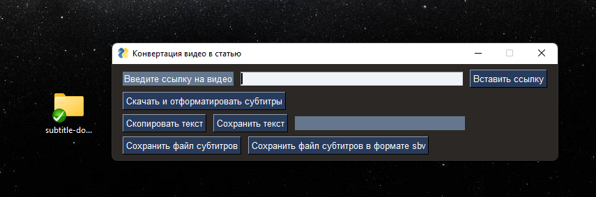

# Subtitle Download ru

Моя попытка обойти правила Яндекс Дзена и сделать генератор статей

Идея простая: брать Ютуб видео, скачивать авто сгенерированные субтитры, очищать их и выдавать в виде готовой статьи

На практике получилось приложение, которое имеет интерфейс и некий обработчик полученных данных

Приложение находится в venv пространстве со всеми нужными пакетами

Имеет в себе также установщик на C:// диск и конфиг файл для его создания

Также есть некоторая попытка в создание нейросети для обработки 
текста, но безуспешно
